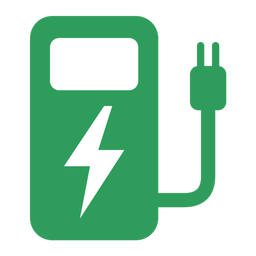

# EVlink Home for Home Assistant

[![GitHub Release][releases-shield]][releases]
[![GitHub Last Commit][last-commit-shield]][repo]
[![GitHub Issues][issues-shield]][issues]
[![HACS][hacs-shield]][hacs]

[![Tests][tests-shield]][tests]
[![Validate][validate-shield]][validate]
[![Release][release-workflow-shield]][release-workflow]

EVlink Home is an unofficial custom integration for Home Assistant that monitors and controls a Schneider Electric EVlink Home Smart Wallbox. It uses the same cloud service as the Wiser Home app, so the Wallbox keeps its configuration and the Wiser Home app keeps working alongside Home Assistant.

## Features

- **Start and Stop charging** from a switch, in automations, dashboards or voice assistants.
- **Status** of the Wallbox, as the cloud reports it.
- **Plugged in** and **Energy flowing** binary sensors for simple automations.
- **Session energy** in kWh, usable in the Energy dashboard.
- **Next scheduled start and end** of the charging schedule set in the Wiser Home app.
- Reauthentication, reconfiguration and diagnostics.

## Supported devices

Known to work:

- Schneider Electric EVlink Home Smart (EVH4 range) added to a Wiser Home account. Tested on the EVH4A07N400F.

Not supported:

- EVlink Home without network interface: it cannot join a Wiser Home account.
- Other EVlink ranges have not been tested.

The integration creates one device per Wallbox of the account. Several Wallboxes on one account should work, but only one has been tested.

## Installation

Requires Home Assistant 2026.10.0 or later, a Wiser Home account, and a Wallbox already set up in the Wiser Home app.

### HACS (recommended)

1. Open HACS in your Home Assistant instance.
2. Click the three dots in the top right corner and select **Custom repositories**.
3. Add the URL of this repository and select **Integration** as the type.
4. Install the **EVlink Home** integration.
5. Restart Home Assistant.

### Manual

1. Download `evlink_home.zip` from the latest release.
2. Extract it into `config/custom_components/evlink_home` in your Home Assistant configuration directory.
3. Restart Home Assistant.

## Configuration

Add the integration: [![Add Integration][add-integration-badge]][add-integration]

1. Go to **Settings** > **Devices & services**.
2. Click **Add integration** and search for **EVlink Home**.
3. Enter the credentials of your Wiser Home account:
    - **Email**: the email address you sign in to the Wiser Home app with.
    - **Password**: the password of that account.

The integration checks the credentials before creating the entry. Each Wiser Home account can be added once.

The integration has no options. To change the email or the password later, open the integration and select **Reconfigure**. The new credentials must belong to the same Wiser Home account.

If the cloud rejects the password, for example after you changed it in the Wiser Home app, Home Assistant asks you to sign in again. The integration does not retry a rejected password on its own, so it never locks your account.

## Entities

Each Wallbox gets these entities:

| Entity | Type | Description |
| --- | --- | --- |
| Charging | Switch | On while the Wallbox charges the car (status `charging` or `suspended_ev`). Turning it on sends Start, turning it off sends Stop. Turning it on with no car plugged in shows an error and sends nothing. |
| Status | Sensor | The state of the Wallbox, see the values below. |
| Session energy | Sensor | Energy delivered during the current Charge session, in kWh. It keeps its last value once the car is unplugged, and starts again from zero with the next session. |
| Next scheduled start | Sensor | Next start of the charging schedule set in the Wiser Home app. |
| Next scheduled end | Sensor | Next end of that schedule. |
| Plugged in | Binary sensor | On while a car is plugged in. Unknown when the status does not tell, for example while the Wallbox is offline. |
| Energy flowing | Binary sensor | On while energy flows to the car (status `charging`). Off when the car does not draw power (`suspended_ev`), even though the Charging switch stays on. |

Status values: `charging`, `plugged_in`, `unplugged`, `schedule_paused`, `paused`, `stopped`, `suspended_ev` (the car does not draw power), `suspended_dso` (suspended by the grid operator), `joining`, `rebooting`, `offline`, `error`, `tripped` and `undefined`. Only a few of them have been seen in practice.

## Data updates

The integration polls the Wiser Home cloud every 30 seconds. The cloud itself refreshes the Wallbox's data about every 30 seconds, so a faster poll would not bring fresher values.

After Start or Stop, the integration refreshes right away. The Wallbox usually follows a command within 2 to 10 seconds. Until the next poll, the Charging switch shows the state you requested.

When the cloud cannot be reached, the entities become unavailable and the integration logs one message. They come back on their own once the cloud answers, with one more message.

## Use cases and examples

- Start charging when solar production exceeds the house consumption, and stop when it drops.
- Stop charging during an expensive tariff period, and start again afterwards.
- Get a notification when the car is plugged in but does not charge.
- Track the energy of each Charge session in the Energy dashboard.

Notify when a car is plugged in but not charging after 10 minutes (adapt the entity ids to your Wallbox's name):

```yaml
automation:
  - alias: "Car plugged in but not charging"
    triggers:
      - trigger: state
        entity_id: binary_sensor.wallbox_plugged_in
        to: "on"
        for: "00:10:00"
    conditions:
      - condition: state
        entity_id: binary_sensor.wallbox_energy_flowing
        state: "off"
    actions:
      - action: notify.notify
        data:
          message: "The car is plugged in but not charging."
```

Start charging at a fixed time:

```yaml
automation:
  - alias: "Start charging at night"
    triggers:
      - trigger: time
        at: "02:00:00"
    conditions:
      - condition: state
        entity_id: binary_sensor.wallbox_plugged_in
        state: "on"
    actions:
      - action: switch.turn_on
        target:
          entity_id: switch.wallbox_charging
```

## Known limitations

- **Cloud dependency.** Everything goes through the Wiser Home cloud: the integration needs an internet connection and stops working if the service is down, changes, or is shut down.
- **Stop shows as `schedule_paused`.** After a Stop, the cloud reports the `schedule_paused` status, not `stopped`.
- **No Disable.** The integration cannot keep the Wallbox from charging when a car is plugged in: the Wallbox follows its own schedule and the Wiser Home app's settings. Turning the switch off stops charging while the Charge session goes on, so the Wallbox may charge again on its own schedule.
- **Read-only schedule.** The schedule and the charging mode are read from the Wiser Home app and cannot be changed from Home Assistant. Charge history and cost are not available.
- **Wallbox time zone.** The cloud sends scheduled times without a time zone. The integration assumes the Wallbox is in Home Assistant's time zone.
- **Session energy after a restart.** After Home Assistant restarts, Session energy stays unknown while no car is plugged in.

## Troubleshooting

### Setup fails with "Could not reach the Wiser Home cloud"

Home Assistant could not reach the cloud. Check that Home Assistant has internet access and that the Wiser Home app shows your Wallbox, then try again.

### Setup fails with "The email or password is incorrect"

Sign in to the Wiser Home app with the same email and password to confirm them, then try again.

### Home Assistant asks to reauthenticate

The cloud rejected the stored password. Open the notification, enter the current password of your Wiser Home account, and the integration reloads.

### Entities are unavailable

The cloud did not answer the last poll. The entities come back on their own once it answers again. If they stay unavailable, check that the Wiser Home app still shows your Wallbox.

### The Charging switch turns back off after I turned it on

The Wallbox did not start charging, so the next poll shows the real state. Check in the Wiser Home app whether the car is ready to charge and whether the Wallbox is in an error state.

### Reporting an issue

Enable debug logging from the integration page (**Enable debug logging**), reproduce the issue, then disable it to download the log. Also download the diagnostics from the integration page (three dots menu, **Download diagnostics**): they hide your email, password, device identifiers, serial numbers and Wi-Fi settings. Attach both to a new [issue][issues].

## Removal

1. Go to **Settings** > **Devices & services** and select **EVlink Home**.
2. Click the three dots next to the entry and select **Delete**.
3. If you installed it with HACS, remove the integration from HACS and restart Home Assistant.

Removing the integration deletes the stored credentials. The Wallbox and the Wiser Home app are not affected.

A Wallbox that no longer belongs to your Wiser Home account can be deleted from its device page.

## Disclaimer

This is an unofficial integration, not affiliated with or endorsed by Schneider Electric. EVlink and Wiser are trademarks of Schneider Electric. The integration relies on a cloud service that Schneider Electric may change at any time. Use it at your own risk.

[hacs]: https://github.com/hacs/integration
[hacs-shield]: https://img.shields.io/badge/HACS-Custom-orange.svg
[last-commit-shield]: https://img.shields.io/github/last-commit/FunFR/ha-evlink-home
[releases]: https://github.com/FunFR/ha-evlink-home/releases
[releases-shield]: https://img.shields.io/github/release/FunFR/ha-evlink-home.svg
[repo]: https://github.com/FunFR/ha-evlink-home
[issues]: https://github.com/FunFR/ha-evlink-home/issues
[issues-shield]: https://img.shields.io/github/issues/FunFR/ha-evlink-home.svg
[tests]: https://github.com/FunFR/ha-evlink-home/actions/workflows/test.yml
[tests-shield]: https://github.com/FunFR/ha-evlink-home/actions/workflows/test.yml/badge.svg
[validate]: https://github.com/FunFR/ha-evlink-home/actions/workflows/validate.yml
[validate-shield]: https://github.com/FunFR/ha-evlink-home/actions/workflows/validate.yml/badge.svg
[release-workflow]: https://github.com/FunFR/ha-evlink-home/actions/workflows/release.yml
[release-workflow-shield]: https://github.com/FunFR/ha-evlink-home/actions/workflows/release.yml/badge.svg
[add-integration]: https://my.home-assistant.io/redirect/config_flow_start/?domain=evlink_home
[add-integration-badge]: https://my.home-assistant.io/badges/config_flow_start.svg
